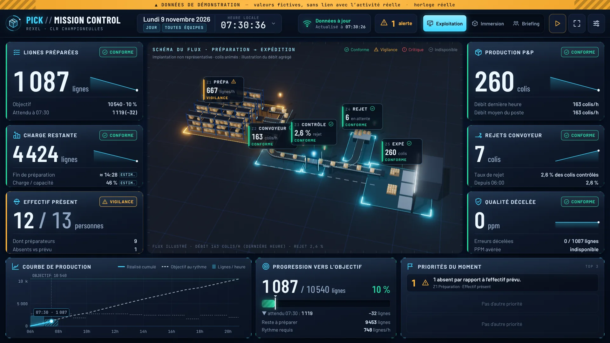

# PICK // MISSION CONTROL

Tableau de pilotage du service Pick & Pack — Rexel CLR Champigneulles.
Conçu pour le Samsung Flip 75" (16:9, tactile, lecture à plusieurs mètres), utilisable sur ordinateur.



Aperçus : [Immersion](apercus/immersion.webp) · [Briefing équipe](apercus/briefing.webp) · [Nouvelle alerte](apercus/alerte.webp) · [Repli 2D sans 3D](apercus/repli-2d.webp) — captures du mode démonstration.

## Lancer l'application

| Cas | Comment |
|---|---|
| **Démo en un seul fichier** | `demo/PICK-Mission-Control-demo.html` (1 Mo, tout intégré) : à ouvrir directement, envoyer par mail ou copier sur clé USB. Régénérer avec `npm run demo`. |
| **Sans installation** | Ouvrir `mission-control/index.html` dans Chrome / Edge (double-clic, clé USB ou dossier partagé). Tout est embarqué : moteur 3D, polices, données de démonstration. Aucun accès internet requis. |
| **Site publié** | Après fusion sur `main` : `https://legros123.github.io/Standard-Pick-Pack/mission-control/` |
| **Serveur local** | `node mission-control/outils/serveur.mjs 8080` puis `http://localhost:8080/mission-control/` |

Sur le Flip : ouvrir l'adresse dans le navigateur, toucher ⛶ (plein écran). Favoris utiles :
`?mode=briefing`, `?mode=immersion`, `?equipe=matin`, `?qualite=moyenne`, `?rendu=2d`.

## Utilisation

- **Trois modes** (en-tête, un geste) : *Exploitation* (défaut), *Immersion* (direction, scène plein cadre), *Briefing* (très gros caractères, point sécurité, 3 priorités du jour).
- **Toucher un indicateur** : historique, objectif, explication de l'écart, règle, données sources.
- **Toucher une zone** (étiquette ou scène) : rapprochement de caméra + détail opérationnel ; *Vue principale* pour revenir.
- **Toucher une alerte / priorité** : faits déclencheurs, règle, action proposée (si définie).
- **Contexte** (date, période, équipe) : toucher la date dans l'en-tête.
- **État des données** : toucher le voyant pour actualiser maintenant.
- ⏸ suspend les animations (l'écran reste complet) ; ⚙ ouvre les réglages (qualité graphique, rendu 3D/2D, source, seuils, horaires, briefing).
- Clavier : `1` `2` `3` modes · `F` plein écran · `Espace` animations · `R` actualiser · `Échap` vue principale.

## Ce qui fonctionne, ce qui est simulé, ce qui reste à connecter

**Fonctionne** : scène 3D Three.js (préparation, convoyeur, contrôle, aiguillage, rejet, expédition), colis animés proportionnels au débit, états de zone (couleur + symbole + mot, colonnes lumineuses), zoom par zone ; ouverture < 2 s ; compteurs et courbes animés sans retour à zéro ; alerte nouvelle → message + impulsion sur la zone ; célébration à l'objectif franchi ; trois modes ; tiroirs de détail ; filtres ; plein écran ; qualité graphique automatique (résolution, reflets, ombres) ; repli 2D si la 3D est indisponible ; respect de « réduire les animations » ; arrêt du rendu quand la page est masquée ; actualisation toutes les 120 s sans recharger ; états *à jour / anciennes / interrompue / indisponibles* avec conservation des dernières valeurs.

**Simulé** : le mode démonstration (bandeau permanent « DONNÉES DE DÉMONSTRATION ») produit des valeurs fictives déterministes (`src/donnees/demo.js`, isolé du connecteur réel). Le schéma 3D n'est pas l'implantation réelle ; les colis animés illustrent un débit agrégé, pas un suivi individuel.

**À connecter** : les exports réels (LOGYS, Requete1 DETAIL/CARTON, OPE_MAJ, equipe_jour.json, vision_board_data.js) n'ont pas été fournis. Voir [`donnees/LISEZMOI.md`](donnees/LISEZMOI.md) : format normalisé, modèle `pick_data.exemple.js`, CSV d'exemple et `outils/exporter_pick_data.py`. Les seuils marqués « à valider » sont des propositions ; les règles validées reprises des sources sont le quota 620 lignes / 7,4 h et la PPM décelée verte sous 1 000.

## Développement

```bash
cd mission-control
npm install          # esbuild 0.28.2, three 0.186.1, polices Barlow / JetBrains Mono (OFL)
npm run build        # src/ → app.js (fichier unique, committé pour fonctionner sans installation)
npm run serve        # serveur local
node outils/verifier.mjs captures   # captures automatiques (modes, états, 1080p, 4K, 1366×768)
```

Architecture : `src/donnees` (import, démo, indicateurs, règles) → `src/app/pilote.js` (actualisation, états) →
`src/ui` (couche HTML nette) et `src/scene` (3D et repli 2D). Réglages par défaut : `src/config/defauts.js`.
